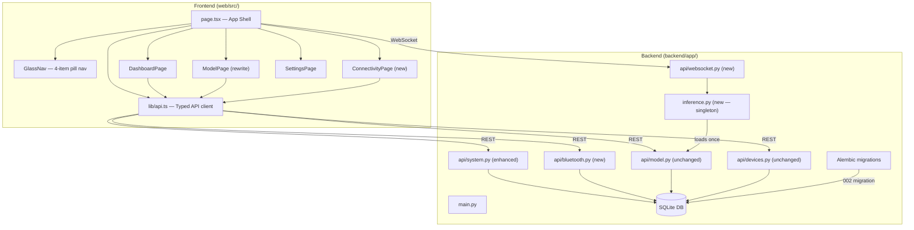

# Design Document

## OptiCore UI and Connectivity Restructure

---

## Overview

This design covers a full-stack restructure of the OptiCore application. The frontend navigation shrinks from six pages (Vision, Camera, Devices, Model, Status, Settings) to four (Dashboard, Model, Connectivity, Settings), all backed by real data from the existing FastAPI backend. The backend gains a WebSocket inference stream, enhanced system-status fields, real OS camera enumeration, and a new Bluetooth management module. All schema changes go through Alembic migrations; no existing tables, columns, or migration files are modified.

The design preserves every existing API contract, database table, and Pydantic schema, while layering new capabilities on top.

---

## Architecture

### High-Level Component Map



### Data Flow Summary

- **Polling (5 s)**: `GET /health` → backend/model status; `GET /api/status` → system metrics
- **WebSocket**: `/ws/inference` → real-time FPS, latency, detection count, inference state
- **On demand**: `GET /api/cameras`, `GET /api/bluetooth/devices`, `GET /api/wifi/devices` → populate Connectivity and Model pages
- **Mutations**: `PUT /api/model/config`, `POST /api/bluetooth/*`, `POST /api/cameras/{id}/request-access`

---

## Components and Interfaces

### 1. Frontend Shell (`web/src/app/page.tsx`)

**Changes from current state:**

- Replace `NavPage` import source from `GlassNav` — new type: `'DASHBOARD' | 'MODEL' | 'CONNECTIVITY' | 'SETTINGS'`
- Default `activePage` state: `'DASHBOARD'`
- Remove imports: `VisionPage`, `CameraPage`, `DevicesPage`, `StatusPage`
- Add imports: `DashboardPage`, `ConnectivityPage`
- Keep `ModelPage` (rewritten), `SettingsPage` (unchanged)
- Keep WebSocket effect (`/ws/inference`) and backend health poll — both feed `SystemState`
- Extend `SystemState` with new fields from enhanced `/api/status`: `wifiConnected`, `wifiSsid`, `wifiIp`, `wifiInterface`, `wifiSignalDbm`, `usbDeviceCount`, `bluetoothAdapterAvailable`, `batteryPercent`, `batteryPlugged`
- Remove `StatusStrip` floating bar (metrics now live on DashboardPage)

```typescript
// New SystemState additions
interface SystemState {
  // ... existing fields ...
  wifiConnected: boolean;
  wifiSsid: string | null;
  wifiIp: string | null;
  wifiInterface: string | null;
  wifiSignalDbm: number | null;
  usbDeviceCount: number;
  bluetoothAdapterAvailable: boolean;
  batteryPercent: number | null;
  batteryPlugged: boolean | null;
}
```

---

### 2. GlassNav (`web/src/components/GlassNav.tsx`)

**Changes:**

```typescript
// Replace
export type NavPage = 'VISION' | 'CAMERA' | 'DEVICES' | 'MODEL' | 'STATUS' | 'SETTINGS';
export const NAV_PAGES: NavPage[] = ['VISION', 'CAMERA', 'DEVICES', 'MODEL', 'STATUS', 'SETTINGS'];

// With
export type NavPage = 'DASHBOARD' | 'MODEL' | 'CONNECTIVITY' | 'SETTINGS';
export const NAV_PAGES: NavPage[] = ['DASHBOARD', 'MODEL', 'CONNECTIVITY', 'SETTINGS'];
```

Remove icon components: `VisionIcon`, `CameraIcon`, `DevicesIcon`, `StatusIcon`.  
Add icon components: `DashboardIcon` (grid/squares), `ConnectivityIcon` (signal/wifi waves).  
Keep: `ModelIcon`, `SettingsIcon`.

`PAGE_ICONS` and `PAGE_LABELS` maps updated accordingly.

---

### 3. OpticoreLogo (`web/src/components/OpticoreLogo.tsx`)

**Single change**: Remove the "VISION LAB" subtitle `<span>` from the `text` block. Keep the SVG mark and "OPTICORE" wordmark unchanged.

```tsx
// Remove this span entirely:
<span style={{ fontSize: markSize * 0.21, ... }}>
  VISION LAB
</span>
```

---

### 4. DashboardPage (`web/src/components/pages/DashboardPage.tsx`) — New file

**Layout**: 2-column glass card grid. Left column: system status indicators. Right column: performance metrics and build info.

**Data sources** (all real, no hardcoding):

| Indicator | Source | Online condition |
|---|---|---|
| Backend | `GET /health` | HTTP 200, response `status: "ok"` |
| Model | `GET /health` | `model_loaded: true` |
| Inference | `/ws/inference` | `running: true` |
| Camera | `GET /api/cameras` | any entry with `status: "connected"` |
| Wi-Fi | `GET /api/status` | `wifi_connected: true` |
| Bluetooth | `GET /api/status` | `bluetooth_adapter_available: true` |
| USB | `GET /api/status` | `usb_device_count` count display |
| Power | `GET /api/status` | `battery_percent` + `battery_plugged` |
| Performance | `/ws/inference` + `/api/status` | FPS, latency, CPU%, RAM%, object count |

**Null handling**: Any field that is `null` or `undefined` from the backend must render as `"UNAVAILABLE"`, `"OFFLINE"`, or `"NOT DETECTED"` (depending on context). No placeholder numbers or demo values are permitted.

**Key component structure:**

```tsx
// StatusCard — reusable glass card with dot + label
function StatusCard({ title, items }: { title: string; items: StatusItem[] })

// StatusItem shape
interface StatusItem {
  label: string;
  value: string;        // displayed value — never undefined
  state: 'online' | 'offline' | 'standby' | 'loading';
}

// PerformanceCard — big metric numbers
function PerformanceCard({ fps, latency, cpu, ram, detectionCount }: PerformanceCardProps)
```

Refresh: parent shell polls `/health` and `/api/status` every 5 s and passes state as props.

---

### 5. ModelPage (`web/src/components/pages/ModelPage.tsx`) — Rewrite

Merges current `VisionPage` + `CameraPage` + `ModelPage` into one page.

**Layout**: 2-column grid — left: `CameraViewport` (existing component, keep as-is), right: collapsible control panel.

**Camera source selector:**
- On mount: `GET /api/cameras` → populate source list dynamically
- Each source entry: `{ id, name, type, status, resolution?, fps? }`
- Sources with `status: "disconnected"` or absent types shown as disabled with "UNAVAILABLE" label
- Selecting a source: `POST /api/cameras/{id}/activate` (new endpoint, see backend section)
- No hardcoded sources — the `CAMERA_SOURCES` constant in the current `CameraPage.tsx` is removed entirely

**YOLO model singleton** (frontend):
- Store a `modelLoaded` ref (`useRef<boolean>`) at the shell level
- Pass it down; `ModelPage` checks the ref before requesting model load
- Model load state is never reset on navigation — once loaded, the ref stays `true`

**Model info**: populated from `GET /api/model` — file name, framework, task, class count, status.  
**Class list**: populated from `GET /api/model` class count and a classes endpoint (or kept as count-only if the backend doesn't expose class names array).

**Sliders**: on change, debounce 400 ms then `PUT /api/model/config` with `{ confidence_threshold, iou_threshold, image_size }`.

**Inference metrics**: consumed from parent `SystemState` (WebSocket stream), not polled separately.

---

### 6. ConnectivityPage (`web/src/components/pages/ConnectivityPage.tsx`) — New file

**Layout**: tab bar (WI-FI | BLUETOOTH | USB/LOCAL) + content panel below.

```tsx
type ConnectivityTab = 'WIFI' | 'BLUETOOTH' | 'USB';

// Default: 'WIFI'
const [activeTab, setActiveTab] = useState<ConnectivityTab>('WIFI');
```

Each tab renders a separate sub-component in the same file.

#### 6a. WiFiSection

Data sources:
- Network state: `GET /api/status` → `wifi_ssid`, `wifi_ip`, `wifi_interface`, `wifi_signal_dbm`, `wifi_connected`
- OptiCore devices: `GET /api/wifi/devices` → `WiFiDevice[]` from `wifi_devices` table only

Network state display (fields shown as "NOT DETECTED" when null):

```
┌─ Network State ─────────────────────┐
│ Status:    CONNECTED / DISCONNECTED  │
│ SSID:      MyNetwork / NOT DETECTED  │
│ IP:        192.168.1.10              │
│ Interface: wlan0                     │
│ Signal:    -55 dBm                   │
└─────────────────────────────────────┘
```

Camera access flow (matches Requirement 16 state machine):
- `idle` state: show [REQUEST CAMERA ACCESS] button
- On click: `POST /api/cameras/{camera_source_id}/request-access` → backend sets state to `pending`
- `pending` state: show animated "Awaiting approval..." indicator
- WebSocket message `{ type: "camera_access_update", camera_source_id, access_state: "approved"|"denied" }` triggers state update
- `approved`: show [OPEN IN MODEL] shortcut button (navigates to Model page with that source pre-selected)
- `denied`: show "ACCESS DENIED" label

Empty state: when `wifi_devices` table returns empty list, show "No OptiCore devices registered on this network."

#### 6b. BluetoothSection

Data sources:
- Adapter: `GET /api/status` → `bluetooth_adapter_available`
- Devices: `GET /api/bluetooth/devices` → `BluetoothDevice[]` from `bluetooth_devices` table

Actions map to these endpoints:
| Button | Endpoint |
|---|---|
| [SCAN] | `POST /api/bluetooth/scan` |
| [CONNECT] | `POST /api/bluetooth/connect` `{ address }` |
| [DISCONNECT] | `POST /api/bluetooth/disconnect` `{ address }` |
| [TEST TTS] | `POST /api/bluetooth/tts-test` |

TTS response: show `routed_to` field value in a toast/status chip.  
Empty state: "No Bluetooth devices detected."

#### 6c. USBSection

Data source: `GET /api/cameras` filtered to `type === "usb"`. Count from `GET /api/status` `usb_device_count`.

Each USB camera entry shows: name, type, status, [USE IN MODEL] button → navigates to Model page with that source pre-selected.

Empty state: "No USB devices detected by the system."

---

### 7. Typed API Client (`web/src/lib/api.ts`) — New file

Central module for all HTTP calls. No `fetch` calls in components directly.

```typescript
const API = process.env.NEXT_PUBLIC_API_URL ?? 'http://localhost:8000';

// Types (matching backend Pydantic schemas exactly)
export interface HealthResponse {
  status: 'ok' | 'degraded';
  database: 'ok' | 'error';
  model_loaded: boolean;
  model_status: string;
  version: string;
}

export interface SystemStatusResponse {
  backend: string;
  cpu: { percent: number; count: number };
  memory: { percent: number; used_mb: number; total_mb: number };
  disk: { percent: number; used_gb: number; total_gb: number };
  cpu_temp: number | null;
  // New fields
  wifi_connected: boolean;
  wifi_ssid: string | null;
  wifi_ip: string | null;
  wifi_interface: string | null;
  wifi_signal_dbm: number | null;
  usb_device_count: number;
  bluetooth_adapter_available: boolean;
  battery_percent: number | null;
  battery_plugged: boolean | null;
}

export interface CameraSourceResponse {
  id: string;
  name: string;
  type: 'local' | 'usb' | 'rtsp' | 'http';
  status: 'connected' | 'disconnected' | 'error';
  resolution?: string;
  fps?: number;
}

export interface BluetoothDeviceResponse {
  id: string;
  device_id: string;
  name: string;
  address: string;
  device_type: string;
  status: 'connected' | 'disconnected' | 'error';
  signal_strength: number | null;
  last_seen: string | null;
}

export interface BluetoothScanResult {
  address: string;
  name: string;
  device_type: string;
  rssi: number | null;
  status: string;
}

export interface WiFiDeviceResponse {
  id: string;
  device_id: string;
  name: string;
  ip_address: string;
  port: number;
  device_type: string;
  status: string;
  last_seen: string | null;
}

export interface ModelResponse {
  id: string;
  name: string;
  version: string;
  file_name: string;
  framework: string;
  task: string;
  class_count: number;
  status: string;
  created_at: string;
}

export interface ModelConfigResponse {
  confidence_threshold: number;
  iou_threshold: number;
  image_size: number;
}

export interface TTSTestResponse {
  status: 'ok';
  routed_to: string;
}

// API function signatures
export const apiClient = {
  getHealth: () => Promise<HealthResponse>,
  getSystemStatus: () => Promise<SystemStatusResponse>,
  getCameras: () => Promise<{ cameras: CameraSourceResponse[] }>,
  getModel: () => Promise<ModelResponse | null>,
  getModelConfig: () => Promise<ModelConfigResponse | null>,
  updateModelConfig: (cfg: Partial<ModelConfigResponse>) => Promise<ModelConfigResponse>,
  getBluetoothDevices: () => Promise<BluetoothDeviceResponse[]>,
  scanBluetooth: () => Promise<BluetoothScanResult[]>,
  connectBluetooth: (address: string) => Promise<BluetoothDeviceResponse>,
  disconnectBluetooth: (address: string) => Promise<void>,
  testTTS: () => Promise<TTSTestResponse>,
  getWifiDevices: () => Promise<WiFiDeviceResponse[]>,
  requestCameraAccess: (cameraSourceId: string) => Promise<{ status: 'pending' }>,
};
```

---

### 8. Backend: `system.py` — Enhanced `/api/status`

Add platform-aware system metric collection. All new fields return `null` on failure — never raise HTTP 4xx/5xx for missing hardware.

```python
# Wi-Fi detection strategy (platform-aware)
import platform, subprocess, re

def get_wifi_info() -> dict:
    """Returns wifi_ssid, wifi_ip, wifi_interface, wifi_signal_dbm, wifi_connected."""
    try:
        system = platform.system()
        if system == "Linux":
            # Use iwgetid for SSID, psutil for IP
            ssid = subprocess.check_output(["iwgetid", "-r"], timeout=2).decode().strip() or None
        elif system == "Darwin":
            out = subprocess.check_output(["/System/Library/PrivateFrameworks/Apple80211.framework/Versions/Current/Resources/airport", "-I"], timeout=2).decode()
            ssid = re.search(r"SSID: (.+)", out).group(1).strip() if re.search(r"SSID: (.+)", out) else None
        elif system == "Windows":
            out = subprocess.check_output(["netsh", "wlan", "show", "interfaces"], timeout=2).decode()
            ssid_match = re.search(r"SSID\s+:\s+(.+)", out)
            ssid = ssid_match.group(1).strip() if ssid_match else None
        # Get IP from psutil net_if_addrs
        ...
    except Exception:
        return {"wifi_connected": False, "wifi_ssid": None, "wifi_ip": None,
                "wifi_interface": None, "wifi_signal_dbm": None}
```

**USB count**: use `psutil` to count removable/USB storage, combined with OpenCV index probe (see camera enumeration below).

**Bluetooth adapter**: use `bleak` scanner availability check or platform command (`hciconfig` on Linux, `Get-PnpDevice` on Windows).

**Battery**: `psutil.sensors_battery()` — returns `None` on desktop systems, never raises.

**New response shape** (extend existing dict):
```python
return {
  # ... existing fields (backend, cpu, memory, disk, cpu_temp) ...
  "wifi_connected": wifi_info["wifi_connected"],
  "wifi_ssid": wifi_info["wifi_ssid"],
  "wifi_ip": wifi_info["wifi_ip"],
  "wifi_interface": wifi_info["wifi_interface"],
  "wifi_signal_dbm": wifi_info["wifi_signal_dbm"],
  "usb_device_count": usb_count,
  "bluetooth_adapter_available": bt_available,
  "battery_percent": battery.percent if battery else None,
  "battery_plugged": battery.power_plugged if battery else None,
}
```

---

### 9. Backend: `system.py` — Real Camera Enumeration (`/api/cameras`)

Replace the hardcoded stub with OS-level enumeration using OpenCV:

```python
import cv2
import platform

def enumerate_cameras() -> list[dict]:
    cameras = []
    # Probe indices 0-4
    for index in range(5):
        cap = cv2.VideoCapture(index)
        if not cap.isOpened():
            cap.release()
            continue
        
        # Distinguish local vs USB
        cam_type = "usb" if index > 0 else "local"
        # On Linux, check /dev/video* path to confirm USB
        if platform.system() == "Linux":
            import os
            path = f"/dev/video{index}"
            if os.path.exists(path):
                # Could use udev to detect USB vs built-in
                cam_type = "usb" if index > 0 else "local"
        
        cameras.append({
            "id": f"camera_{index}",
            "name": f"Camera {index}" if index > 0 else "Built-in Camera",
            "type": cam_type,
            "status": "connected",
            "resolution": None,  # could read cap.get(cv2.CAP_PROP_FRAME_WIDTH)
            "fps": int(cap.get(cv2.CAP_PROP_FPS)) or 30,
        })
        cap.release()
    return cameras
```

`GET /api/cameras` returns `{"cameras": enumerate_cameras()}` — empty list when none found.

---

### 10. Backend: `api/bluetooth.py` — New Module

```python
router = APIRouter(prefix="/api/bluetooth", tags=["bluetooth"])

@router.get("/devices")    # Query bluetooth_devices table for current user's devices
@router.post("/scan")      # bleak.BleakScanner.discover(), upsert results into bluetooth_devices
@router.post("/connect")   # bleak connect by address, update status in bluetooth_devices
@router.post("/disconnect")# bleak disconnect, update status
@router.post("/tts-test")  # pyttsx3 synthesis, route to BT audio output if available
```

**Dependency**: `bleak` for BT operations (cross-platform: Windows/Linux/macOS), `pyttsx3` for TTS.

**Error handling**: All `BleakError` or OS-level exceptions → `HTTPException(503, detail=str(e))`.

**`POST /api/bluetooth/scan` response**:
```python
class BluetoothScanResult(BaseModel):
    address: str
    name: str
    device_type: str   # heuristic from name/service UUIDs
    rssi: Optional[int]
    status: str        # "available"
```

**`POST /api/bluetooth/tts-test` logic**:
```python
# 1. Get connected BT audio devices from bluetooth_devices table
# 2. If found and pyttsx3 driver supports it: route to that device
# 3. Otherwise: route to system default
# 4. Return {"status": "ok", "routed_to": "<device_name_or_default>"}
```

---

### 11. Backend: `api/websocket.py` — New Module

```python
from fastapi import WebSocket, WebSocketDisconnect
import asyncio, json

router = APIRouter(tags=["websocket"])

@router.websocket("/ws/inference")
async def inference_websocket(websocket: WebSocket):
    await websocket.accept()
    try:
        while True:
            model = get_model()  # from inference.py singleton
            if model is not None and inference_state.running:
                payload = {
                    "running": True,
                    "fps": inference_state.fps,
                    "latency": inference_state.latency_ms,
                    "detection_count": inference_state.detection_count,
                    "confidence_threshold": inference_state.confidence,
                    "iou_threshold": inference_state.iou,
                }
                await websocket.send_text(json.dumps(payload))
                await asyncio.sleep(1.0)   # ≥1 Hz when running
            else:
                await websocket.send_text(json.dumps({"running": False}))
                await asyncio.sleep(5.0)   # keepalive every 5s when idle
    except WebSocketDisconnect:
        pass
```

`inference_state` is a module-level `InferenceState` dataclass managed by `inference.py`.

---

### 12. Backend: `inference.py` — YOLO Singleton

```python
# backend/app/inference.py
from typing import Optional
import os
from app.config import settings

_model = None
_model_loaded = False

class InferenceState:
    running: bool = False
    fps: float = 0.0
    latency_ms: float = 0.0
    detection_count: int = 0
    confidence: float = 0.5
    iou: float = 0.45

inference_state = InferenceState()

def get_model():
    """Return cached YOLO model, loading it once if needed."""
    global _model, _model_loaded
    if _model_loaded:
        return _model
    try:
        from ultralytics import YOLO
        path = settings.model_path
        if os.path.exists(path):
            _model = YOLO(path)
            _model_loaded = True
    except Exception:
        _model = None
        _model_loaded = True  # mark as attempted — don't retry on every call
    return _model
```

Called at startup in `main.py` via a `lifespan` event or direct import, ensuring the model file is loaded before the first request.

---

### 13. Backend: `main.py` — Title Fix

```python
# Change
app = FastAPI(title="OptiCore Vision Lab Backend Application", ...)

# To
app = FastAPI(title="OptiCore Backend", ...)
```

Add `websocket` router import and `app.include_router(websocket.router)`.

---

### 14. Backend: New Pydantic Schemas

**`backend/app/schemas/device.py`** — add to existing file:

```python
class WiFiDeviceResponse(BaseModel):
    id: str
    device_id: str
    name: str
    ip_address: str
    port: int
    device_type: str
    status: str
    last_seen: Optional[datetime]
    class Config:
        from_attributes = True
```

**`backend/app/schemas/bluetooth.py`** — new file:

```python
class BluetoothDeviceResponse(BaseModel):
    id: str
    device_id: str
    name: str
    address: str
    device_type: str
    status: str
    signal_strength: Optional[int]
    last_seen: Optional[datetime]
    class Config:
        from_attributes = True

class BluetoothScanResult(BaseModel):
    address: str
    name: str
    device_type: str
    rssi: Optional[int]
    status: str

class BluetoothConnectRequest(BaseModel):
    address: str

class TTSTestResponse(BaseModel):
    status: str
    routed_to: str
```

**`backend/app/schemas/system.py`** — new file:

```python
class SystemStatusResponse(BaseModel):
    backend: str
    cpu: dict
    memory: dict
    disk: dict
    cpu_temp: Optional[float]
    wifi_connected: bool
    wifi_ssid: Optional[str]
    wifi_ip: Optional[str]
    wifi_interface: Optional[str]
    wifi_signal_dbm: Optional[int]
    usb_device_count: int
    bluetooth_adapter_available: bool
    battery_percent: Optional[float]
    battery_plugged: Optional[bool]

class CameraEnumerationResponse(BaseModel):
    cameras: List[CameraSourceResponse]
```

---

### 15. Database Migration: `002_add_camera_access_state.py`

**Path**: `backend/alembic/versions/002_add_camera_access_state.py`

```python
"""Add access_state column to camera_sources

Revision ID: 002
Revises: 001
Create Date: ...
"""
from alembic import op
import sqlalchemy as sa

revision = '002'
down_revision = '001'
branch_labels = None
depends_on = None

def upgrade() -> None:
    op.add_column(
        'camera_sources',
        sa.Column('access_state', sa.String(20), nullable=False, server_default='idle')
    )

def downgrade() -> None:
    op.drop_column('camera_sources', 'access_state')
```

Also add the column to the `CameraSource` SQLAlchemy model in `backend/app/database/models.py`:
```python
access_state = Column(String(20), default="idle")  # idle, pending, approved, denied
```

---

### 16. Camera Access Authorization Endpoint

**New endpoint** in `backend/app/api/devices.py` (or a new `cameras.py` module):

```
POST /api/cameras/{camera_source_id}/request-access
```

Logic:
1. Look up `CameraSource` by `camera_source_id`
2. Set `access_state = "pending"`
3. Look up the associated `WiFiDevice` via the `Device` relationship
4. If a WebSocket connection exists for that device, relay `{ type: "camera_access_request", camera_source_id }`
5. Return `{"status": "pending"}`

When the remote device responds via WebSocket with `{ type: "camera_access_response", camera_source_id, approved: bool }`:
- Set `access_state = "approved"` or `"denied"`
- Push `{ type: "camera_access_update", camera_source_id, access_state }` to the frontend WebSocket

---

### 17. Typography Contrast Fixes (`web/src/app/globals.css`)

```css
/* Before */
--text-secondary: #A6ACB8;
--text-muted: #707784;

/* After */
--text-secondary: #C4CAD4;
--text-muted: #9AA2AE;
```

Add utility class:
```css
.text-shadow-contrast {
  text-shadow: 0 1px 4px rgba(0, 0, 0, 0.5);
}
```

Increase glass panel base opacity in `.glass` from `0.055` to `0.070` to improve text/background contrast ratio on dark surfaces.

---

## Data Models

### Existing Models (unchanged structure)

All existing SQLAlchemy models (`User`, `Session`, `Device`, `CameraSource`, `Model`, `ModelConfig`, `InferenceSession`, `DetectionEvent`, `DeviceEvent`, `BluetoothDevice`, `WiFiDevice`) remain intact with their existing columns and relationships.

### Modified Model

**`CameraSource`** — one new column added via migration 002:
```
access_state: String(20), default="idle"
Valid values: "idle" | "pending" | "approved" | "denied"
```

### New Pydantic Schema Files

| File | Purpose |
|---|---|
| `backend/app/schemas/bluetooth.py` | Bluetooth request/response schemas |
| `backend/app/schemas/system.py` | Extended status and camera enumeration schemas |

### WebSocket Message Shapes

**Inference stream** (from backend to frontend):
```typescript
// Active inference
{ running: true, fps: number, latency: number, detection_count: number,
  confidence_threshold: number, iou_threshold: number }

// Idle keepalive
{ running: false }

// Camera access update
{ type: "camera_access_update", camera_source_id: string, 
  access_state: "approved" | "denied" }
```

---

## Correctness Properties

*A property is a characteristic or behavior that should hold true across all valid executions of a system — essentially, a formal statement about what the system should do. Properties serve as the bridge between human-readable specifications and machine-verifiable correctness guarantees.*

---

### Property 1: Navigation Completeness

*For any* render of the `GlassNav` component, the navigation bar SHALL contain exactly four items with labels `["DASHBOARD", "MODEL", "CONNECTIVITY", "SETTINGS"]` in that exact order, and none of the legacy labels `["VISION", "CAMERA", "DEVICES", "STATUS"]` SHALL appear.

**Validates: Requirements 1.1, 1.3**

---

### Property 2: Active Navigation Style

*For any* `NavPage` value passed as the `active` prop to `GlassNav`, the corresponding nav item SHALL have a background of `rgba(255,255,255,0.105)`, a border of `rgba(255,255,255,0.15)`, and contain an active dot indicator element, while all other items SHALL NOT have those styles.

**Validates: Requirements 1.4**

---

### Property 3: Dashboard Status Mapping

*For any* `SystemState` object, the `DashboardPage` SHALL render Status_Indicators for all nine required components (Backend, Model, Inference, Camera, Wi-Fi, Bluetooth, USB, Power, Performance), and each indicator's displayed state SHALL be a deterministic function of the corresponding field(s) in `SystemState` — no indicator state SHALL depend on any field not assigned to it.

**Validates: Requirements 2.1, 2.2, 2.3, 2.4, 2.5, 2.6, 2.7, 2.8, 2.9**

---

### Property 4: Null Value Fallback

*For any* `SystemState` where one or more status fields are `null` or `undefined`, the `DashboardPage` SHALL render the fallback string `"UNAVAILABLE"`, `"OFFLINE"`, or `"NOT DETECTED"` for those fields — it SHALL NOT render a numeric zero, an empty string, or any fabricated value.

**Validates: Requirements 2.12**

---

### Property 5: Performance Metrics Passthrough

*For any* valid WebSocket inference message containing `{ fps, latency, detection_count }`, the `DashboardPage` and `ModelPage` SHALL display those exact values in their respective metric fields — the displayed value SHALL equal the received value with no transformation other than number-to-string formatting.

**Validates: Requirements 2.10, 3.5**

---

### Property 6: Model Load Idempotence

*For any* sequence of navigation events that visits `ModelPage` N times (N ≥ 1), the YOLO model load function SHALL be called exactly once across the entire application session — visiting `ModelPage` more than once SHALL NOT trigger additional model loads.

**Validates: Requirements 3.2**

---

### Property 7: Camera Source Selector Accuracy

*For any* response from `GET /api/cameras`, the camera source selector on `ModelPage` SHALL display exactly the sources returned by the API with their exact `status` values — sources with `status !== "connected"` SHALL be shown as disabled/unavailable, and no camera entries SHALL appear that were not present in the API response.

**Validates: Requirements 3.4, 15.1, 15.5**

---

### Property 8: Model Metadata Completeness

*For any* `ModelResponse` returned by `GET /api/model`, the `ModelPage` SHALL display all five required metadata fields (file name, framework, task, class count, status) — no field SHALL be omitted from the render when the API provides it.

**Validates: Requirements 3.7**

---

### Property 9: Connectivity Tab Structure

*For any* render of the `ConnectivityPage`, the tab bar SHALL contain exactly three tabs in the order `["WI-FI", "BLUETOOTH", "USB / LOCAL"]`, and the content panel SHALL display only the content corresponding to the currently active tab.

**Validates: Requirements 4.1, 4.2**

---

### Property 10: Wi-Fi Field Mapping

*For any* `SystemStatusResponse` from `GET /api/status`, the Wi-Fi sub-section SHALL display the `wifi_ssid`, `wifi_ip`, `wifi_interface`, `wifi_signal_dbm`, and `wifi_connected` fields exactly as returned — fields that are `null` SHALL display `"NOT DETECTED"` and SHALL NOT display any other string.

**Validates: Requirements 5.1, 5.2**

---

### Property 11: Camera Access State Machine

*For any* `CameraSource`, its `access_state` SHALL only ever transition along the valid paths `idle → pending → approved` or `idle → pending → denied` — it SHALL never skip a state, transition backward, or enter a state not in `{idle, pending, approved, denied}`.

**Validates: Requirements 16.1, 16.2, 16.4, 16.5**

---

### Property 12: Backend Status Endpoint Fault Tolerance

*For any* host OS configuration (including platforms with no Wi-Fi adapter, no battery, no Bluetooth adapter, or restricted subprocess access), the `GET /api/status` endpoint SHALL return HTTP 200 with `null` for unavailable fields — it SHALL NOT return HTTP 4xx or 5xx due to missing hardware or unsupported platform features.

**Validates: Requirements 10.5**

---

### Property 13: WebSocket Message Schema

*For any* inference session where `running: true`, every message emitted on `/ws/inference` SHALL contain all six required fields: `running`, `fps`, `latency`, `detection_count`, `confidence_threshold`, and `iou_threshold` — no required field SHALL be absent from an active-inference message.

**Validates: Requirements 13.2**

---

### Property 14: API Response Field Consistency

*For any* API endpoint that returns data for a resource type (camera, bluetooth device, wifi device, model), the response object SHALL contain all fields defined in the corresponding Pydantic schema — no field named in the schema SHALL be absent from the serialized response, and no field name SHALL differ in spelling or casing from the schema definition.

**Validates: Requirements 14.5**

---

## Error Handling

### Frontend Error States

| Scenario | Behavior |
|---|---|
| `/health` request fails or times out (3 s) | `backendOnline = false`, Backend indicator shows OFFLINE |
| `/api/status` returns non-200 | All extended fields (`wifi_*`, `battery_*`, etc.) default to `null` / `false`, display fallback strings |
| WebSocket disconnects | Auto-reconnect after 5 s delay, infinite retries; all WS-sourced fields show last known value during reconnect |
| `GET /api/cameras` returns empty list | Model page camera selector shows empty state "NO CAMERA DETECTED" |
| `GET /api/bluetooth/devices` returns empty | Bluetooth section shows empty state |
| `PUT /api/model/config` fails | Slider snaps back to previous value; show inline error chip |
| `POST /api/bluetooth/scan` returns 503 | Show error message "Bluetooth scan failed — adapter may be unavailable" |
| Camera access request denied | Display "ACCESS DENIED" badge on the camera source row |
| Camera access request times out (no response from remote device) | After 30 s, revert to `idle` state and allow user to re-request |

### Backend Error Handling Rules

1. **Never raise HTTP 5xx for missing hardware** — all platform-metric functions are wrapped in `try/except`, returning `null` values on failure
2. **Bluetooth OS failures** → `HTTP 503` with a descriptive `detail` message
3. **Camera enumeration** — failed `cv2.VideoCapture` attempts are silently skipped; endpoint always returns 200
4. **WebSocket disconnections** — server-side `WebSocketDisconnect` caught and logged; no unhandled exception propagates
5. **Model not found** — `GET /api/model` returns `null` (HTTP 200 with null body), never 404 when the file simply hasn't been placed yet

---

## Testing Strategy

### Unit Tests

Verify specific, concrete behaviors:

- `GlassNav` renders exactly 4 items with correct labels and order
- `DashboardPage` renders "OFFLINE" when `backendOnline` is `false`
- `DashboardPage` renders "UNAVAILABLE" for every null field in `SystemState`
- `ConnectivityPage` defaults to WI-FI tab on first render
- `WiFiSection` renders "NOT DETECTED" for all fields when status returns null values
- `BluetoothSection` renders empty state when device list is empty
- `ModelPage` shows "NO CAMERA DETECTED" when camera API returns empty list
- Backend `/api/status` returns HTTP 200 when all platform queries raise exceptions
- Backend `/api/cameras` returns empty list when no OpenCV index opens
- Backend `get_model()` returns the same object on repeated calls (singleton check)
- `002_add_camera_access_state.py` migration adds the column and sets default to `"idle"`

### Property-Based Tests

Using **Hypothesis** (Python) for backend properties and **fast-check** (TypeScript/Jest) for frontend properties.

Minimum 100 iterations per test. Each test is tagged with its design property reference.

**Backend (Hypothesis)**:

```python
# Feature: opticore-ui-connectivity-restructure, Property 12: Backend Status Endpoint Fault Tolerance
@given(st.booleans(), st.booleans(), st.booleans())
def test_api_status_never_raises(wifi_available, bt_available, battery_available):
    """For any combination of platform feature availability, /api/status returns 200."""
    ...

# Feature: opticore-ui-connectivity-restructure, Property 11: Camera Access State Machine
@given(st.sampled_from(["idle", "pending", "approved", "denied"]),
       st.sampled_from(["approve", "deny", "request"]))
def test_camera_access_state_transitions(current_state, action):
    """Only valid state transitions are permitted."""
    ...

# Feature: opticore-ui-connectivity-restructure, Property 13: WebSocket Message Schema
@given(st.floats(min_value=0, max_value=120), st.floats(min_value=0, max_value=5000), st.integers(min_value=0))
def test_ws_inference_message_has_all_fields(fps, latency, detection_count):
    """Every active-inference WS message contains all 6 required fields."""
    ...

# Feature: opticore-ui-connectivity-restructure, Property 14: API Response Field Consistency
@given(st.builds(ModelResponse, ...))
def test_model_response_fields_match_schema(model):
    """Serialized model response contains all schema fields with correct names."""
    ...
```

**Frontend (fast-check / Jest + React Testing Library)**:

```typescript
// Feature: opticore-ui-connectivity-restructure, Property 1: Navigation Completeness
fc.assert(fc.property(fc.constant(null), () => {
  const { getAllByRole } = render(<GlassNav active="DASHBOARD" onChange={() => {}} />);
  const items = getAllByRole('button');
  expect(items).toHaveLength(4);
  expect(items.map(i => i.textContent)).toEqual(
    expect.arrayContaining(['Dashboard', 'Model', 'Connectivity', 'Settings'])
  );
}));

// Feature: opticore-ui-connectivity-restructure, Property 4: Null Value Fallback
fc.assert(fc.property(
  fc.record({ wifiSsid: fc.constant(null), wifiIp: fc.constant(null), ... }),
  (nullState) => {
    const { queryByText } = render(<DashboardPage state={nullState} />);
    // No numeric zeroes or empty strings for null fields
    expect(queryByText('0')).toBeNull();
    // Must show fallback strings
    expect(queryByText(/UNAVAILABLE|OFFLINE|NOT DETECTED/i)).not.toBeNull();
  }
));

// Feature: opticore-ui-connectivity-restructure, Property 6: Model Load Idempotence
fc.assert(fc.property(fc.integer({ min: 1, max: 20 }), (renderCount) => {
  const loadModel = jest.fn();
  // Simulate N renders of ModelPage
  for (let i = 0; i < renderCount; i++) {
    renderModelPage({ loadModel });
  }
  expect(loadModel).toHaveBeenCalledTimes(1);
}));

// Feature: opticore-ui-connectivity-restructure, Property 5: Performance Metrics Passthrough
fc.assert(fc.property(
  fc.record({ fps: fc.float({ min: 0, max: 120 }), latency: fc.float({ min: 0, max: 5000 }), detection_count: fc.nat() }),
  (wsMessage) => {
    const { getByText } = render(<DashboardPage wsMessage={wsMessage} />);
    expect(getByText(String(Math.round(wsMessage.fps)))).toBeTruthy();
  }
));
```

### Integration Tests

Use representative examples (1–3 per scenario) for behaviors involving OS hardware or cross-service calls:

- Start backend, call `GET /api/cameras` — verify response is a list (may be empty), all entries have `id`, `name`, `type`, `status`
- Call `POST /api/bluetooth/scan` — verify HTTP 200 or HTTP 503 (not 500), response matches `BluetoothScanResult[]` schema
- Call `GET /api/status` — verify all 14 fields present in response, no field raises exception
- WebSocket `/ws/inference` — connect, wait 6 s, verify at least one `{running: false}` keepalive message received
- `POST /api/cameras/{id}/request-access` on a valid camera source — verify `access_state` becomes `"pending"` in DB
- Migration 002 up/down — verify column added on upgrade, removed on downgrade without affecting other columns
